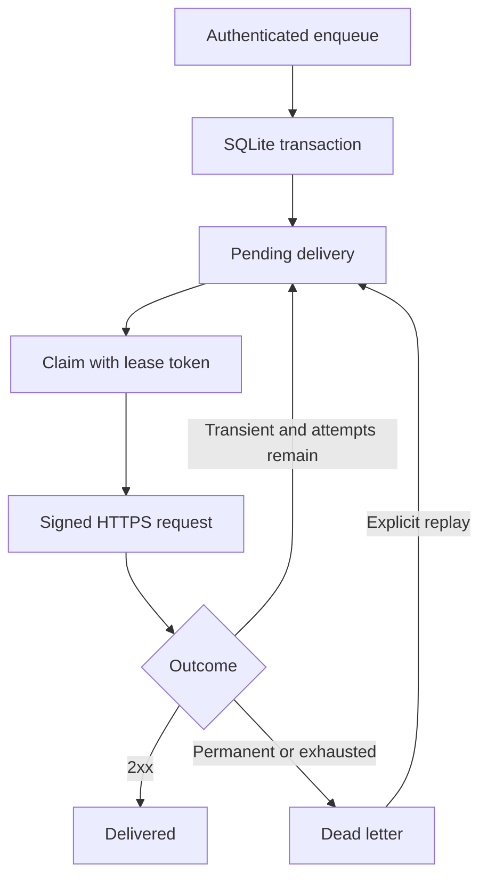

# RelayKit

A durable webhook delivery service in Go. Accept an event once, record every delivery attempt, retry transient failures, and replay dead letters without losing their history.

**Portfolio MVP v0.1.** This repository demonstrates backend correctness and failure handling in a runnable, deliberately small service. It is not a claim of production traffic, enterprise readiness, or exactly-once delivery.

## What is implemented

- Authenticated HTTP API with strict JSON validation and a 64 KiB request limit.
- SQLite WAL queue with `synchronous=FULL`, immediate transactions and durable attempt history.
- Unique idempotency keys: same key and request return the existing event; a changed request returns HTTP 409.
- Atomic claims, expiring leases and fencing tokens so a stale worker cannot overwrite a newer result.
- Exponential backoff, bounded `Retry-After`, dead letters and explicit replay cycles.
- HMAC-SHA256 signatures with timestamps and stable delivery IDs.
- HTTPS destination policy, private/reserved IP filtering at connection time, IP-pinned dialing, and no redirects or environment proxies.
- Deterministic integration tests using a fake clock and real local HTTP servers; concurrency tests run under Go's race detector.

## Quickstart: watch a delivery recover from an outage

Requires Go 1.25.3 or later, a C compiler (the SQLite driver uses CGO), `curl`, and Python 3 for the shell example. Linux/macOS are supported by the CLI. Windows users can use WSL2 or Docker. Tested locally with Go 1.25.3 on Linux; Docker configuration is provided but has not been executed in this environment.

In terminal 1, from the project directory:

```bash
cp .env.example .env
python3 - <<'PY'
import secrets
from pathlib import Path
Path('.env').write_text(
    'RELAY_API_TOKEN=' + secrets.token_hex(32) + '\n'
    'RELAY_SIGNING_SECRET=' + secrets.token_hex(32) + '\n'
    'RELAY_ALLOW_LOCAL_DEMO=true\n'
)
Path('.env').chmod(0o600)
PY
set -a; . ./.env; set +a
go run ./cmd/receiver
```

In terminal 2:

```bash
set -a; . ./.env; set +a
go run ./cmd/relaykit
```

In terminal 3:

```bash
set -a; . ./.env; set +a
curl -s http://127.0.0.1:8080/healthz
curl -s http://127.0.0.1:8080/v1/deliveries \
  -H "Authorization: Bearer $RELAY_API_TOKEN" \
  -H 'Content-Type: application/json' \
  -H 'Idempotency-Key: order-1001' \
  -d '{"destination":"http://127.0.0.1:9090/hook","payload":{"event":"order.created","order_id":1001}}'
```

The receiver deliberately returns 503 twice, then 200. Copy the returned `delivery.id` and inspect its attempt history:

```bash
curl -s http://127.0.0.1:8080/v1/deliveries/DELIVERY_ID \
  -H "Authorization: Bearer $RELAY_API_TOKEN" | python3 -m json.tool
```

Within several seconds, status becomes `delivered`, `attempts` is 3, and history contains 503, 503, 200. Repeat the enqueue command: it returns HTTP 200 with `created: false` and the same ID. Change the payload while keeping the key: HTTP 409. Stop and restart RelayKit: the database and history remain. Delete `data/` only when you intentionally want a fresh demo.

## API

All `/v1/` routes require `Authorization: Bearer <RELAY_API_TOKEN>`. The health endpoint is unauthenticated. See [openapi.yaml](openapi.yaml) for the machine-readable contract.

| Method | Path | Behavior |
|---|---|---|
| GET | `/healthz` | Database readiness; 200 or 503 |
| POST | `/v1/deliveries` | Enqueue with `Idempotency-Key`; 202 new, 200 duplicate, 409 conflict |
| GET | `/v1/deliveries` | Latest 100 deliveries, newest first |
| GET | `/v1/deliveries/{id}` | Delivery and attempt history |
| POST | `/v1/deliveries/{id}/replay` | Requeue a dead letter; 202, or 409 if not dead |

Replay keeps the delivery ID, payload and idempotency key, increments `cycle`, and resets the cycle's attempt count. History retains all earlier cycles. A recipient should continue deduplicating by delivery ID.

Idempotency compares the destination string and whitespace-compacted JSON payload. JSON object key order is significant; this is not a semantic JSON canonicalization scheme. Keys are retained for the life of the database. Payloads are returned as JSON-encoded strings in delivery records. Timestamps in queue records are Unix milliseconds; signature timestamps are RFC 3339 UTC.

## Delivery and failure semantics



- The CLI runs one worker, polls every 250 ms, and permits five attempts per cycle.
- Network failures, HTTP 408/425/429 and 5xx retry. Other non-2xx responses, including redirects, go directly to dead letters.
- Delays are 1, 2, 4, 8 seconds between the five attempts, with a general cap of one minute. A positive integer `Retry-After` can extend a delay up to that cap; HTTP-date values are not implemented.
- HTTP timeout is 10 seconds; the claim lease is 30 seconds. After a crash, expired claims are recovered on the next worker tick. An expired final attempt becomes dead with an explicit unknown-outcome error.
- **At-least-once delivery:** a receiver can process a request before the sender crashes or times out. A retry may repeat the side effect. Consumers must persistently deduplicate `X-Relay-ID` with their business transaction. The demo receiver uses an in-memory map only.
- A fencing token prevents late completion from corrupting a reclaimed job. It cannot undo an external webhook side effect.

## Signature verification

The outgoing headers are `X-Relay-ID`, `X-Relay-Timestamp`, `X-Relay-Attempt`, and `X-Relay-Signature`. The signature is lowercase hexadecimal HMAC-SHA256 over:

```text
timestamp + "." + delivery_id + "." + exact_request_body_bytes
```

Use a constant-time comparison, reject timestamps outside your tolerance, and deduplicate the delivery ID. `relay.VerifySignature` and the receiver demonstrate a five-minute tolerance. Signatures provide integrity and authenticity, not payload encryption. HTTPS provides transport encryption. One global signing secret is intentionally used in this MVP; per-endpoint secret management and rotation are future work.

## Security boundaries

Default destination policy permits only public HTTPS on port 443, with normal TLS certificate verification. Credentials and fragments in URLs are rejected. Every DNS result must pass the IP policy; the connection uses a checked IP while retaining the original hostname for TLS. Redirects, environment proxies and HTTP connection reuse are disabled. Private, loopback, link-local, documentation and selected special-use ranges are blocked; IPv6 is restricted to global unicast with additional exclusions. IP policy needs maintenance as allocations change. Egress firewall rules are recommended before Internet exposure.

`RELAY_ALLOW_LOCAL_DEMO=true` additionally permits HTTP/HTTPS to literal loopback addresses for the receiver. It does not permit arbitrary LAN hosts. Never enable it on an Internet-facing deployment. Default API bind is loopback. For a remote deployment, add a TLS reverse proxy, endpoint allowlists, rate limits, quotas and observability first.

Do not enqueue secrets in URL query strings or payloads. Authorized API clients can read all deliveries. Database, WAL and backups contain plaintext payloads and destination URLs; protect their storage. New files use restrictive permissions. Credentials are read from environment variables, not logged, and `.env` is ignored by Git.

## Configuration

| Variable | Default | Purpose |
|---|---|---|
| `RELAY_API_TOKEN` | Required | At least 24 characters; generate randomly |
| `RELAY_SIGNING_SECRET` | Required | Different random secret, at least 24 characters |
| `RELAY_DB` | `./data/relaykit.db` | SQLite file on local persistent storage |
| `RELAY_ADDR` | `127.0.0.1:8080` | API listen address |
| `RELAY_ALLOW_LOCAL_DEMO` | `false` | Explicit loopback demo destinations |

Docker Compose uses a named volume and exposes the API on host loopback. Supply secrets through `.env`, then run `docker compose up --build`. Compose forces demo mode off; use an authorized public HTTPS receiver. A host loopback receiver is not reachable as container loopback. Container images are not a substitute for dependency updates; update the pinned Go base version before a real deployment.

## Verification

```bash
go test -race -count=1 ./...
go vet ./...
go build -buildvcs=false ./cmd/relaykit ./cmd/receiver
python3 scripts/smoke.py
```

Tests cover transient recovery and signature correctness, permanent failures, retry caps, dead-letter replay, restart persistence, lease fencing, final-attempt crash recovery, concurrent idempotency/claims across database handles, HTTP validation/auth, SSRF address policy and redirect rejection. No test needs a public webhook service or real credentials. CI runs the same checks.

The optional smoke script starts both compiled binaries with temporary storage and random ephemeral secrets, verifies the 503 → 503 → 200 flow, duplicate/conflict behavior, and persistence after a process restart. It needs free local ports 18080 and 9090; it cleans up its processes and database when done. CI runs the Go checks; run this script locally for the binary-level demonstration.

## Deliberate limits and next steps

This is a single-tenant, single-host MVP with one worker, one SQLite writer, no performance benchmark and no uptime claim. It has no user accounts, tenant isolation, destination ownership verification, queue admission quotas, deletion/retention policy, migration versioning, dashboards, metrics exporter, retry jitter, backup automation or encryption at rest. The list endpoint is capped at 100 and has no pagination. SQLite WAL must use a local filesystem, not a shared network volume. Do not deploy it unchanged as a public multi-tenant webhook platform.

Useful next milestones: per-endpoint encrypted secrets and rotation; receiver ownership challenge; metrics and queue-age alerts; configurable retention; randomized retry jitter; benchmark-driven capacity limits; and a PostgreSQL queue if multi-host operation becomes a requirement.

## Code map

- `internal/relay/store.go` — SQL schema, transactions, queue lifecycle and history.
- `internal/relay/worker.go` — HTTP delivery, classification and scheduling.
- `internal/relay/security.go` — destination policy, safe dialer and HMAC helpers.
- `internal/relay/api.go` — authenticated API and request validation.
- `internal/relay/relay_test.go` — integration and concurrency tests.
- `cmd/relaykit` — configuration, HTTP server and graceful shutdown.
- `cmd/receiver` — intentionally flaky local receiver.

Implementation references: [Go net/http](https://pkg.go.dev/net/http), [SQLite WAL](https://sqlite.org/wal.html), [SQLite synchronous](https://sqlite.org/pragma.html#pragma_synchronous), [go-sqlite3](https://github.com/mattn/go-sqlite3).
